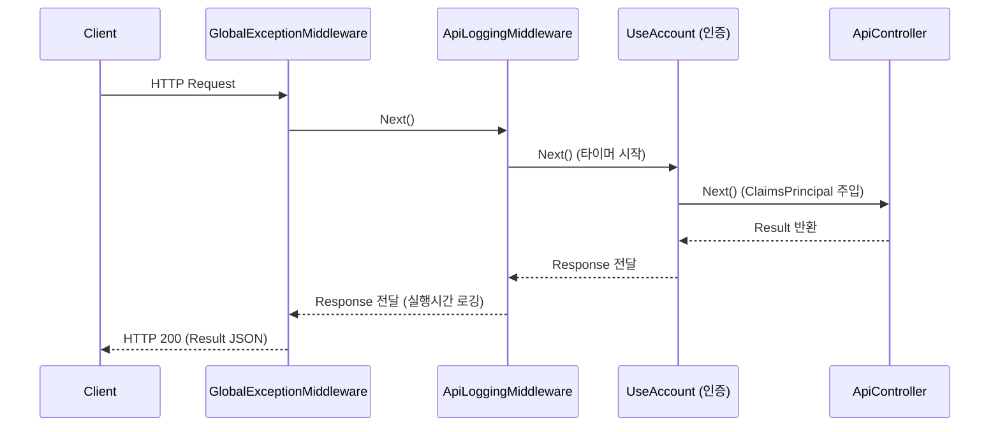

# BitPlus.Web.Site.Middlewares 폴더 개요

## 1. 폴더 역할 및 책임
`BitPlus.Web.Site.Middlewares`는 HTTP 파이프라인의 전후 처리를 담당하는 **커스텀 미들웨어(Custom Middleware)**들을 정의합니다.
요청/응답 로깅, 전역 예외 처리(Global Exception Handling), 보안 헤더 처리 등을 수행하여 애플리케이션의 안정성과 모니터링 편의성을 극대화합니다.

---

## 2. 파일 목록 및 구현 상세

| 파일명 | 유형 | 역할 및 세부 내용 |
| :--- | :--- | :--- |
| `SetupGuardExtend.cs` | static class | `UseSetupGuard(installed)`: 설치 전에는 /Setup 외 요청을 막음(GET → /Setup 이동, 그 외 503 Result), 설치 후에는 /Setup 을 404 로 막음. 정적 파일 뒤, 인증 앞에 등록. |
| `VisitCounterExtend.cs` | static class | `AddVisitCounter()`·`UseVisitCounter()`: 페이지 요청(GET, Accept text/html, `/api`·확장자 경로 제외)마다 일간 페이지 수를 세고, `Visit` 쿠키(값 = 오늘 날짜 yyyyMMdd, 그날 자정 만료)가 오늘 것이 아니면 새로 발급하며 방문자 수를 셈. 설치 후에만, 설치 안내 뒤에 등록. |
| `VisitCounter.cs` | class (싱글턴) | 업로드 폴더 `Counter/` 파일 집계 — 일별 `{yyyyMM}/{dd}.json`, 월 모음 `{yyyyMM}/month.json`(그날 이전 날별 기록을 한 파일에, `{"01": {pages, visitors}, ...}`), 연 모음 `{yyyy}.json`(끝난 달별 합, `{"01": {...}, ...}`). 날짜는 서버 시각의 날짜. 그날 파일이 없으면 월 모음을 다시 쓰고 새로 만들며, 달의 첫 파일이면 지난달 모음을 마감하고 그 해 연 모음을 다시 씀. 오늘 값은 메모리에 모아 10초마다·종료 시 씀(서버 한 대 기준). |
| `VisitCount.cs` | class | 카운터 파일 한 개의 값 `{pages, visitors}`. |
| `ApiLoggingMiddleware.cs` | class | API 요청/응답 로깅 미들웨어. • 요청 경로, HTTP Method, 쿼리스트링, 클라이언트 IP, 요청 시각 기록. • 요청 처리 후 `Stopwatch`로 실행 시간(ms) 및 응답 상태코드(HTTP Status Code) 기록. • 민감 정보(비밀번호, 토큰 등)는 정규식 또는 마스킹 필터링. • 소요 시간이 긴 요청(예: 1초 초과)은 Warning 레벨로 기록. |
| `GlobalExceptionMiddleware.cs` | class | 전역 처리되지 않은 예외 핸들러. • 컨트롤러 및 하위 서비스에서 발생한 모든 미처리 예외를 가로챔. • `ILogger`를 통해 스택 트레이스 및 요청 컨텍스트를 Error 레벨로 파일 영속화. • 클라이언트에는 표준 JSON `Result.Fail("서버 내부 오류가 발생했습니다.")` 반환 (개발 모드인 경우 상세 스택트레이스 포함). |

---

## 3. 미들웨어 등록 순서 및 흐름

---

## 4. 코딩 규칙 준수 사항
- 파일당 하나의 미들웨어 클래스만 선언 (`One Type Per File`).
- 생성자에서 `RequestDelegate` 및 `ILogger` 초기화 및 `this.` 명시.
- 인라인 단문 제어문 준수.
